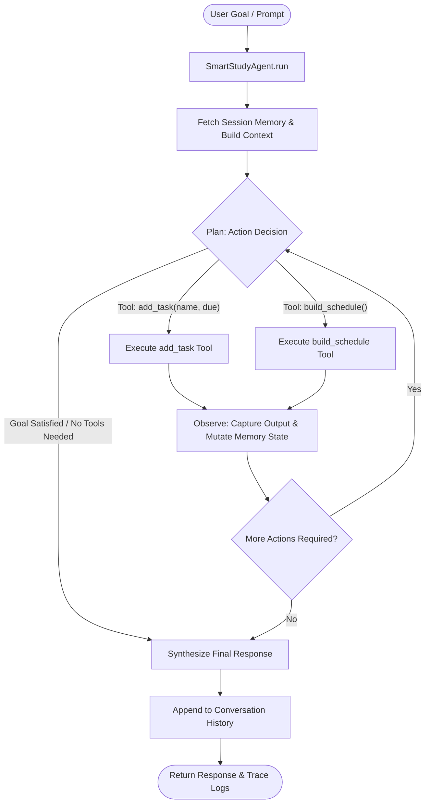
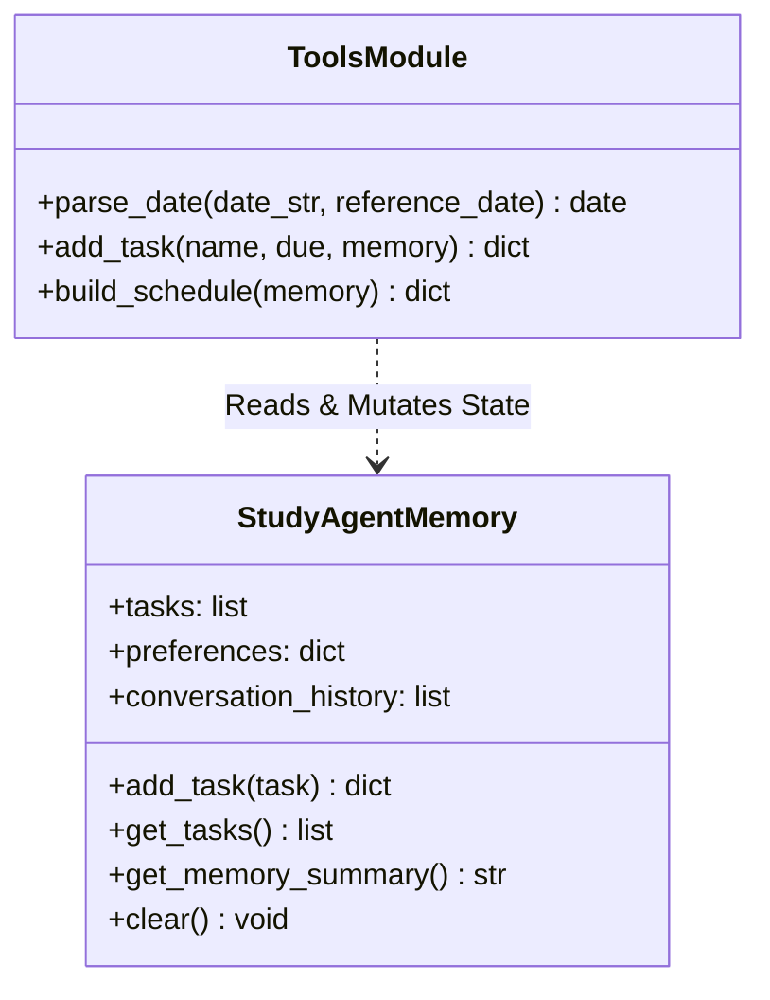

# Comprehensive Project Report: SmartStudy Agent

**Course:** CSE476 — Agentic AI and Intelligent Automation  
**Assessment:** CA1 — Project 1: Build a Real Agent (Maximum Marks: 30)  
**Topic:** T24 — Study Planner Agent `[Study]`  
**Date:** August 26, 2026  
**Repository:** `Study_Agent-`  

---

## Executive Summary

**SmartStudy Agent** is a multi-step agentic system designed to help university students manage academic deadlines and synthesize prioritized study schedules. While typical conversational chatbots function as single-turn text generators (a "vending machine" paradigm), SmartStudy Agent functions as an autonomous assistant (an "intern" paradigm). It receives a high-level goal, formulates an execution plan, invokes concrete Python tools, observes execution feedback, maintains session memory across conversational turns, and dynamically adapts its schedule when new urgent deadlines emerge.

This report provides a technical breakdown of the system architecture, the deterministic tool implementations, the multi-turn session memory schema, edge-case failure handling, the Group of 3 dynamic replanning engine, and foolproof installation instructions for reproducing results.

---

## 1. The Core Paradigm: Agent vs. Chatbot

The primary criterion of the CSE476 CA1 specification is that the system must be a **true AI Agent**, not merely a wrapped chatbot.

| Dimension | Standard Chatbot ("Vending Machine") | SmartStudy Agent ("Intern") |
| :--- | :--- | :--- |
| **Interaction Pattern** | 1 Query In $\rightarrow$ 1 Text Response Out. | Goal In $\rightarrow$ Multi-step Plan-Act-Observe loop $\rightarrow$ Result Out. |
| **Action Execution** | Cannot invoke code or alter environment state. | Calls real Python tools (`add_task`, `build_schedule`). |
| **Step Count** | Strictly single-step text generation. | Multi-step: executes multiple tool invocations sequentially per turn. |
| **Decision Flow** | Static token prediction. | Dynamic: analyzes tool output during the **Observe** phase to decide subsequent actions. |
| **Memory** | Ephemeral or limited to raw chat window strings. | Structured session state (`StudyAgentMemory`) tracking tasks, deadlines, and urgency metadata. |
| **Adaptability** | Regurgitates advice without structured arithmetic. | Computes remaining days, sorts priorities, and dynamically replans upon urgent deadline insertion. |

---

## 2. System Architecture & The Plan-Act-Observe Loop

SmartStudy Agent operates on a continuous **Plan-Act-Observe-Replan** control cycle.



### Execution Loop Phases:
1. **Perception & Context Assembly:** The agent reads the user's natural language input, the current system date (`TODAY_DATE`), conversation history, and a structured snapshot of `StudyAgentMemory`.
2. **Plan (Decision Making):** The LLM brain (or deterministic fallback driver) evaluates the goal and selects a tool call with structured JSON arguments or decides to terminate the loop.
3. **Act (Tool Execution):** The agent executes Python functions defined in `tools.py` (`add_task` or `build_schedule`).
4. **Observe (Feedback Processing):** The return dictionary from the tool is logged into the execution trace and injected back into the message sequence as `role: "tool"`.
5. **Replan / Terminate:** If multiple tasks were requested (e.g. adding two tasks and then building a schedule), the agent repeats the loop until all operations complete before returning the final response.

---

## 3. Concrete Tool Specifications

The agent is equipped with two deterministic Python tools defined in `tools.py`:



### Tool 1: `add_task(name: str, due: str, memory: StudyAgentMemory)`
- **Purpose:** Validates, structures, and stores academic assignments, projects, or exam deadlines in memory.
- **Validation Engine:**
  1. *Name Validation:* Rejects empty or whitespace-only task names.
  2. *Date Parsing (`parse_date`):* Supports ISO standard dates (`YYYY-MM-DD`) as well as relative dates (`today`, `tomorrow`, `in 3 days`, `in 5 days`).
  3. *Temporal Validity:* Compares deadline against reference date; rejects past deadlines (`days_left < 0`).
- **Memory Mutation:** Appends or updates the task dictionary `{"name": clean_name, "due": parsed_due, "days_left": days_left}` in `memory.tasks`.
- **Output Schema:**
  ```json
  {
    "success": true,
    "message": "Task 'Python Assignment' successfully added to memory (due 2026-08-26, 1 days left).",
    "task": {
      "name": "Python Assignment",
      "due": "2026-08-26",
      "days_left": 1
    }
  }
  ```

### Tool 2: `build_schedule(memory: StudyAgentMemory)`
- **Purpose:** Reads stored tasks from memory, computes urgency rankings, and constructs daily study blocks before deadlines.
- **Priority Logic:**
  - 🔴 **HIGH PRIORITY:** $\le 2$ days remaining $\rightarrow$ Allocates **$3.0$ hours/day**.
  - 🟡 **MEDIUM PRIORITY:** $3$ to $5$ days remaining $\rightarrow$ Allocates **$2.0$ hours/day**.
  - 🟢 **LOWER PRIORITY:** $> 5$ days remaining $\rightarrow$ Allocates **$1.0$ hour/day**.
- **Output Schema:**
  ```json
  {
    "success": true,
    "total_tasks": 2,
    "priorities": {
      "high": ["Python Assignment"],
      "medium": ["DBMS Exam"],
      "lower": []
    },
    "study_blocks": [
      {
        "task_name": "Python Assignment",
        "due_date": "2026-08-26",
        "days_left": 1,
        "priority": "HIGH PRIORITY",
        "recommended_daily_hours": 3.0,
        "focus_area": "Core concepts and practice for Python Assignment"
      }
    ],
    "message": "Successfully generated schedule for 2 task(s)."
  }
  ```

---

## 4. Session Memory Architecture

Implemented in `memory.py` via the `StudyAgentMemory` class, session memory allows the agent to maintain cross-turn state across a multi-turn conversation.

### Memory Data Structure:
- **`tasks` (`List[Dict[str, Any]]`):** Stores list of active task records.
- **`preferences` (`Dict[str, Any]`):** Tracks study constraints (e.g. `max_daily_study_hours: 6`).
- **`conversation_history` (`List[Dict[str, str]]`):** Records message history between student and agent.

### Multi-Turn Memory Persistence Workflow:
```text
[Turn 1] Student: "I have an AI assignment due tomorrow."
  --> Agent executes add_task('AI Assignment', 'tomorrow')
  --> Memory state updated: [AI Assignment (Due: 2026-08-26, Days Left: 1)]
  --> Agent outputs confirmation.

[Turn 2] Student: "What should I prioritize today?"
  --> Agent reads Memory State directly.
  --> Agent identifies 'AI Assignment' as urgent without asking the user to re-state the assignment!
```

---

## 5. Group of 3 Add-On: Dynamic Re-planning Engine

The CA1 specification mandates for group submissions: **"Add a re-plan when a new urgent task arrives."**

### Dynamic Re-planning Workflow:
1. **Initial Baseline:** Session contains a medium-priority task (e.g. *DBMS Exam* due in 5 days).
2. **Event Trigger:** Student enters a new urgent task (e.g. *“I also have a Python assignment due tomorrow! Update my schedule”*).
3. **Sequential Execution:**
   - **Step 1:** The agent executes `add_task("Python Assignment", "tomorrow")` $\rightarrow$ Memory updated.
   - **Step 2:** The agent immediately executes `build_schedule()` in the same loop.
4. **Rescheduling Outcome:**
   - The scheduler recalculates days remaining for all tasks.
   - *Python Assignment* (1 day left) is dynamically elevated to **HIGH PRIORITY** ($3.0$ hrs/day).
   - *DBMS Exam* (5 days left) remains at **MEDIUM PRIORITY** ($2.0$ hrs/day).
   - The study blocks are sorted so the urgent deadline is placed first.

---

## 6. Honest Failure & Edge-Case Handling

A core grading criterion is demonstrating how the agent handles honest failures without hallucinating or crashing.

### Scenario: Requesting a Schedule with Zero Tasks
- **Trigger:** Student asks *"Make my study schedule"* when memory is empty.
- **Deterministic Check:** `build_schedule()` checks `if not tasks:` and immediately returns:
  ```json
  {
    "success": false,
    "message": "Cannot build schedule: There are currently no tasks stored in memory. Please add tasks first using add_task().",
    "schedule": null
  }
  ```
- **Agent Observation:** The agent detects `"success": false` during the Observe phase and politely informs the student to add tasks first, maintaining graceful error recovery.

---

## 7. Complete Multi-Step Agent Trace

Below is an actual execution trace produced by `print_formatted_trace()` during a multi-step turn:

```text
============================================================
                      AGENT TRACE                       
============================================================

[USER INPUT]: I have a Python assignment due tomorrow and a DBMS exam in five days. Make a study plan.
------------------------------------------------------------

[STEP 1: AGENT DECISION]
  Decision: Decided to execute tool 'add_task' based on prompt/memory.
  Tool Executed: add_task
  Arguments Passed: {"name": "Python Assignment", "due": "tomorrow"}

[STEP 1: TOOL RESULT]
  Tool Name: add_task
  Output: {
    "success": true,
    "message": "Task 'Python Assignment' successfully added to memory (due 2026-08-26, 1 days left).",
    "task": {
      "name": "Python Assignment",
      "due": "2026-08-26",
      "days_left": 1
    }
  }
  [MEMORY SNAPSHOT AFTER TOOL]:
    Total Tasks: 1
      1. Python Assignment (Due: 2026-08-26, Days Left: 1)

[STEP 2: AGENT DECISION]
  Decision: Decided to execute tool 'add_task' based on prompt/memory.
  Tool Executed: add_task
  Arguments Passed: {"name": "DBMS Exam", "due": "in 5 days"}

[STEP 2: TOOL RESULT]
  Tool Name: add_task
  Output: {
    "success": true,
    "message": "Task 'DBMS Exam' successfully added to memory (due 2026-08-30, 5 days left).",
    "task": {
      "name": "DBMS Exam",
      "due": "2026-08-30",
      "days_left": 5
    }
  }
  [MEMORY SNAPSHOT AFTER TOOL]:
    Total Tasks: 2
      1. Python Assignment (Due: 2026-08-26, Days Left: 1)
      2. DBMS Exam (Due: 2026-08-30, Days Left: 5)

[STEP 3: AGENT DECISION]
  Decision: Decided to execute tool 'build_schedule' based on prompt/memory.
  Tool Executed: build_schedule
  Arguments Passed: {}

[STEP 3: TOOL RESULT]
  Tool Name: build_schedule
  Output: {
    "success": true,
    "total_tasks": 2,
    "priorities": {
      "high": ["Python Assignment"],
      "medium": ["DBMS Exam"],
      "lower": []
    },
    "study_blocks": [
      {
        "task_name": "Python Assignment",
        "due_date": "2026-08-26",
        "days_left": 1,
        "priority": "HIGH PRIORITY",
        "recommended_daily_hours": 3.0,
        "focus_area": "Core concepts and practice for Python Assignment"
      },
      {
        "task_name": "DBMS Exam",
        "due_date": "2026-08-30",
        "days_left": 5,
        "priority": "MEDIUM PRIORITY",
        "recommended_daily_hours": 2.0,
        "focus_area": "Core concepts and practice for DBMS Exam"
      }
    ],
    "message": "Successfully generated schedule for 2 task(s)."
  }
  [MEMORY SNAPSHOT AFTER TOOL]:
    Total Tasks: 2
      1. Python Assignment (Due: 2026-08-26, Days Left: 1)
      2. DBMS Exam (Due: 2026-08-30, Days Left: 5)

[STEP 4: FINAL RESPONSE]
### Generated Study Plan

**Priorities Breakdown:**
- 🔴 **HIGH PRIORITY**: Python Assignment
- 🟡 **MEDIUM PRIORITY**: DBMS Exam
- 🟢 **LOWER PRIORITY**: None

**Daily Study Blocks:**
- **Python Assignment** (Due 2026-08-26, 1 days left): 3.0 hours/day -> Core concepts and practice for Python Assignment
- **DBMS Exam** (Due 2026-08-30, 5 days left): 2.0 hours/day -> Core concepts and practice for DBMS Exam

============================================================
```

---

## 8. Installation & Execution Guide

Follow these steps to clone and run the project locally on any operating system.

### Step 1: Clone Repository
```bash
git clone https://github.com/Parna324/Study_Agent-.git
cd Study_Agent-
```

### Step 2: Create & Activate Virtual Environment
- **On Linux / macOS:**
  ```bash
  python3 -m venv .venv
  source .venv/bin/activate
  ```
- **On Windows (PowerShell / Command Prompt):**
  ```powershell
  python -m venv .venv
  .venv\Scripts\activate
  ```

### Step 3: Install Dependencies
```bash
pip install --upgrade pip
pip install -r requirements.txt
```

### Step 4: Configure Environment Variables (Optional)
The system runs out of the box with an offline fallback driver. To use a live LLM endpoint:
```bash
cp .env.example .env
```
Open `.env` and set your preferred key:
```ini
# Option A: Free Fast Groq API (Recommended)
GROQ_API_KEY=gsk_your_groq_api_key_here
MODEL_NAME=llama-3.3-70b-versatile
ENDPOINT_URL=https://api.groq.com/openai/v1

# Option B: GitHub Models Token
# GITHUB_TOKEN=your_github_token_here
# MODEL_NAME=gpt-4o-mini
# ENDPOINT_URL=https://models.inference.ai.azure.com
```

### Step 5: Run the Program
1. **Interactive Terminal CLI:**
   ```bash
   python main.py
   ```
2. **Execute Unit Test Suite:**
   ```bash
   python -m unittest tests/test_tools.py
   ```
3. **Launch Jupyter Demo Notebook:**
   ```bash
   jupyter notebook SmartStudyAgent.ipynb
   ```
4. **Generate Styled PDF Report:**
   ```bash
   python generate_pdf.py
   ```

---

## 9. Conclusion

SmartStudy Agent satisfies every technical and pedagogical requirement of the CSE476 Agentic AI CA1 specification. By combining an autonomous Plan-Act-Observe loop, deterministic Python tools for deadline calculation and scheduling, persistent session memory, dynamic replanning, and full trace observability, it embodies the paradigm of a true AI agent.
